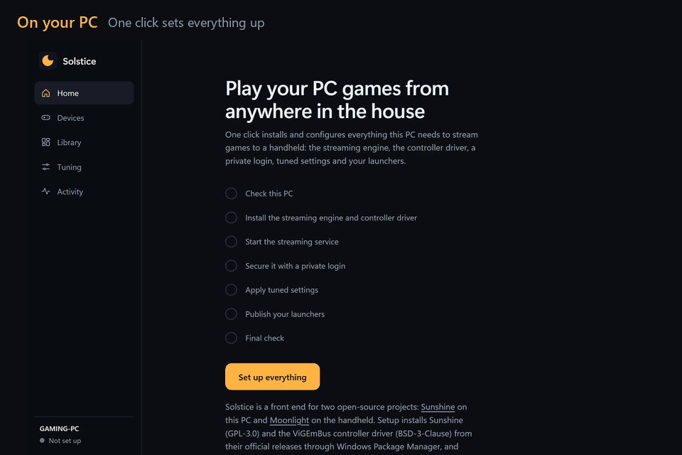
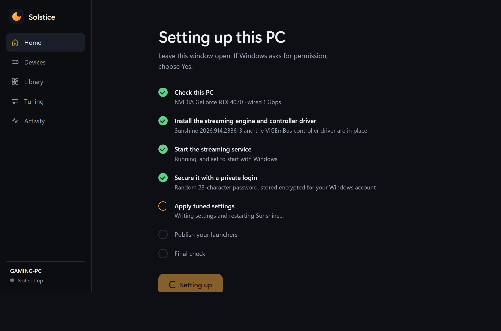
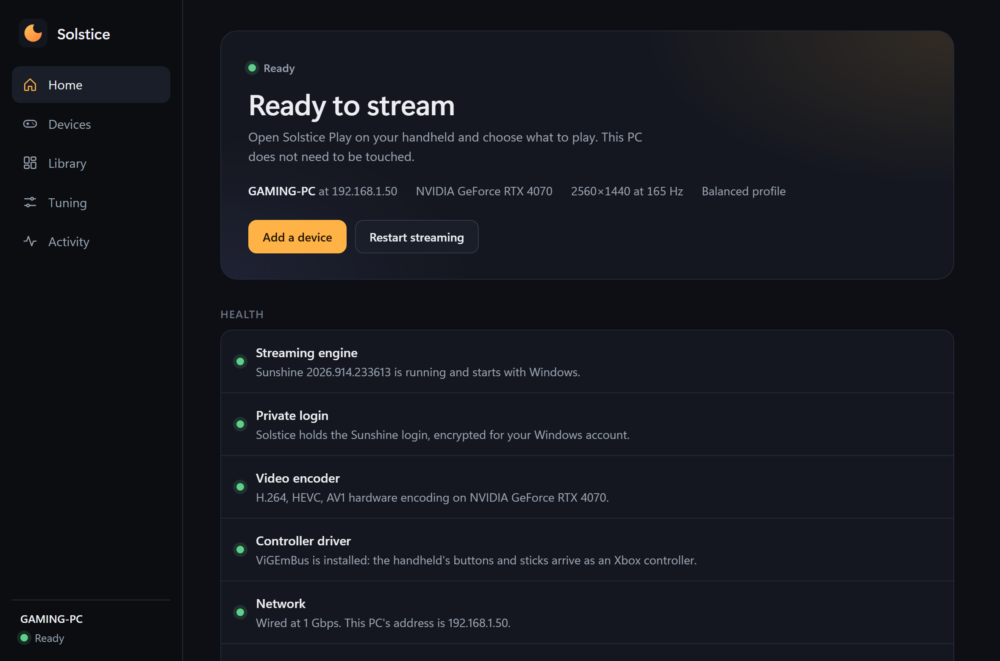
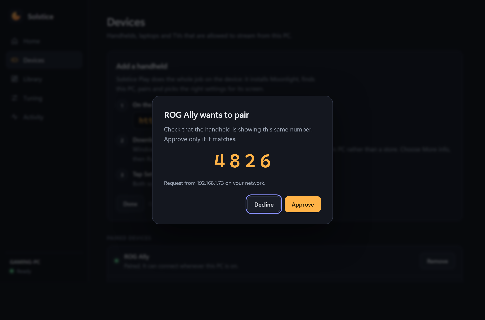
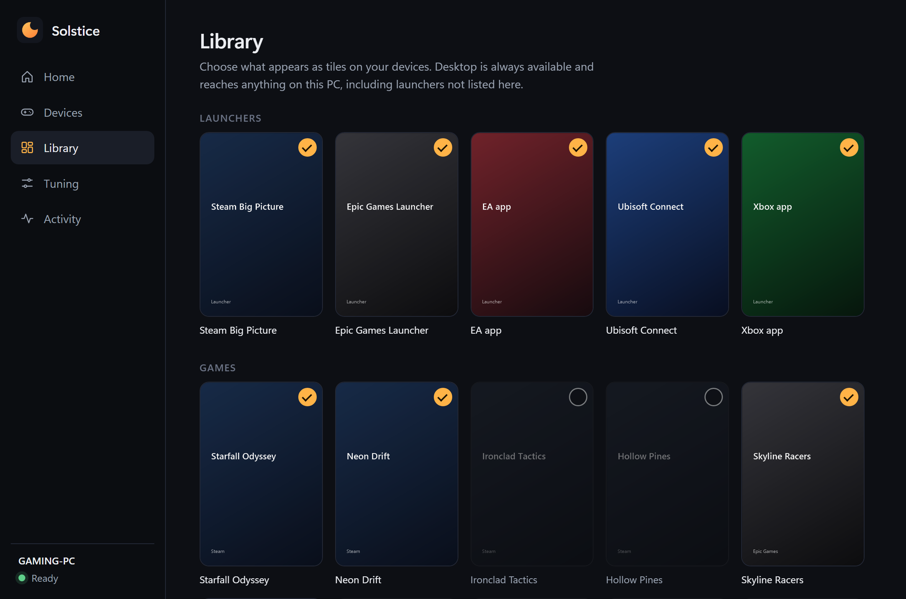
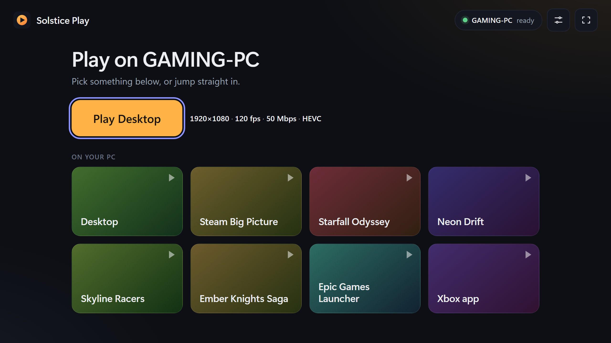
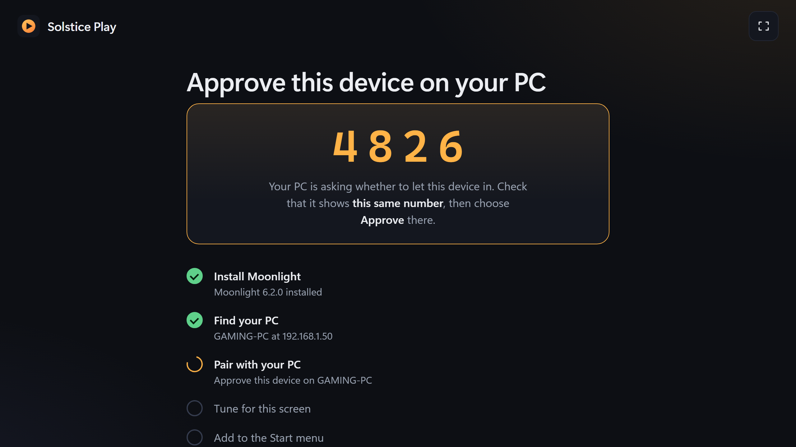
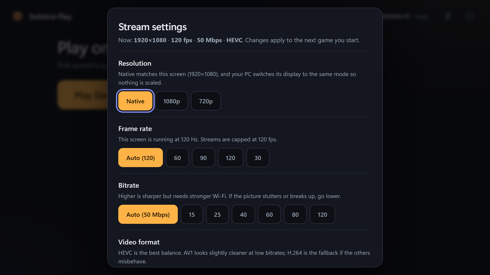

<div align="center">


# Solstice — One-Click PC Game Streaming to ROG Ally & Windows Handhelds

### Stream PC games to a ROG Ally, Legion Go or MSI Claw · Sunshine & Moonlight set up for you · One-tap pairing · Native 1080p 120 Hz · Wake-on-LAN · Steam, Epic, EA, Ubisoft & Xbox

**Solstice is a free, open-source front end for Sunshine and Moonlight: one click sets up your Windows gaming PC as a low-latency game streaming host, and one tap on your handheld finds it, pairs and starts playing, for every launcher.**

[](https://github.com/PriyanshuGeTRekT/solstice-pc-game-streaming-sunshine-moonlight/releases/latest)
[](https://github.com/PriyanshuGeTRekT/solstice-pc-game-streaming-sunshine-moonlight/releases)
[](https://github.com/PriyanshuGeTRekT/solstice-pc-game-streaming-sunshine-moonlight/stargazers)
[](https://github.com/PriyanshuGeTRekT/solstice-pc-game-streaming-sunshine-moonlight/forks)
[](https://hits.sh/github.com/PriyanshuGeTRekT/solstice-pc-game-streaming-sunshine-moonlight/)
[](https://github.com/PriyanshuGeTRekT/solstice-pc-game-streaming-sunshine-moonlight/actions/workflows/build.yml)

[](https://github.com/PriyanshuGeTRekT/solstice-pc-game-streaming-sunshine-moonlight/issues)
[](https://github.com/PriyanshuGeTRekT/solstice-pc-game-streaming-sunshine-moonlight/commits/main)
[](LICENSE)


[](https://github.com/LizardByte/Sunshine)
[](https://github.com/moonlight-stream/moonlight-qt)

[**⬇️ Download Solstice for your PC**](https://github.com/PriyanshuGeTRekT/solstice-pc-game-streaming-sunshine-moonlight/releases/latest/download/Solstice.zip) · [**⬇️ Solstice Play for your handheld**](https://github.com/PriyanshuGeTRekT/solstice-pc-game-streaming-sunshine-moonlight/releases/latest/download/SolsticePlay.exe)

[Website](https://priyanshugetrekt.github.io/solstice-pc-game-streaming-sunshine-moonlight/) · [Features](#features) · [Screenshots](#screenshots) · [Install](#installation) · [ROG Ally guide](#setting-up-a-rog-ally) · [FAQ](#faq)

<br>



</div>

---

## What is Solstice?

[Sunshine](https://github.com/LizardByte/Sunshine) and [Moonlight](https://github.com/moonlight-stream/moonlight-qt) are the best way to play your PC games on a handheld: lower latency than Steam Remote Play, every launcher works, and they are free. **Setting them up is the hard part.** You install a service, a controller driver and a client; pick a web password; type PINs; add each launcher by hand; find the right encoder, resolution and bitrate settings; and then the PC doesn't show up because Windows calls your home network "Public".

**Solstice** is two small apps that do all of that for you:

- **Solstice**, on the gaming PC: one click installs Sunshine and the controller driver from their official releases, secures Sunshine with a private login, applies tuned settings, adds your launchers and games with box art, and keeps an eye on everything afterwards.
- **Solstice Play**, on the handheld: one tap installs Moonlight, finds your PC, pairs (you approve on the PC, nothing to type), sizes the stream to the screen, wakes the PC when it's asleep and launches games, all with the controller.

| | |
|---|---|
| 🖱️ **One click, one tap** | No web admin page, no PINs, no config files. |
| ⚡ **Native and low-latency** | Games render at the handheld's own resolution and refresh rate, and are encoded by the GPU's hardware encoder. |
| 🎮 **Every launcher** | Steam, Epic, EA, Ubisoft, Xbox, GOG, Battle.net and Playnite, or the whole desktop. |
| 🔒 **Locked down** | Private login, admin page limited to the PC, pairing only with your approval. |
| 💸 **Free & open source** | MIT licensed. Sunshine and Moonlight stay unmodified and come from their official releases. |

## Table of contents

- [What is Solstice?](#what-is-solstice)
- [Features](#features)
- [Screenshots](#screenshots)
- [Requirements](#requirements)
- [Installation](#installation)
- [Setting up a ROG Ally](#setting-up-a-rog-ally)
- [How it works](#how-it-works)
- [Privacy and safety](#privacy-and-safety)
- [Known limitations](#known-limitations)
- [FAQ](#faq)
- [Roadmap](#roadmap)
- [Contributing](#contributing)
- [License](#license)

## Features

### 🖥️ One-click PC setup

- Installs **Sunshine** and the **ViGEmBus** controller driver from their official releases through Windows Package Manager, behind **one** Windows administrator prompt.
- Starts the streaming service and sets it to start with Windows, and opens the firewall for it.
- Creates a **random 28-character Sunshine login** and keeps it encrypted for your Windows account, so you never see Sunshine's password page.
- Checks the GPU's **hardware encoder** (H.264, HEVC, AV1) and that Sunshine can see the controller driver before calling it done.

### 🤝 One-tap pairing

- Solstice serves **Solstice Play** to your handheld over the home network. Open an address on the handheld, download, run.
- The handheld shows **four digits**; the PC shows a prompt with the **same four digits**. Click **Approve**. No PIN to type.
- Plain Moonlight devices (TV, phone, Steam Deck) pair the classic way: type the PIN Moonlight shows into Solstice.

### 📺 Native resolution, low latency

- **Match the handheld's screen.** For the length of a session, the PC's monitor switches to the handheld's resolution and refresh rate (for example 1080p at 120 Hz on a ROG Ally), so games render natively instead of being scaled down from 1440p or 4K. It switches back afterwards.
- **Per-screen defaults** on the handheld: native resolution, up to 120 fps, a bitrate sized to the pixels and frame rate (50 Mbps for 1080p/120), HEVC, V-Sync off for the lowest input delay.
- **Encoder profiles**: *Lowest latency*, *Balanced* or *Best picture*, mapped to the right NVIDIA NVENC, AMD AMF and Intel Quick Sync settings.

### 🎮 Every launcher, with box art

- Finds **Steam** (and installed Steam games), **Epic Games** (and installed Epic games), **EA app**, **Ubisoft Connect**, **Xbox app**, **GOG Galaxy**, **Battle.net** and **Playnite**.
- Tick what should appear on the handheld. Box art comes from the launcher's own cache where it exists.
- **Desktop** is always there and reaches anything else on the PC.

### 🌙 Wake, play, quit

- Solstice Play learns the PC's hardware address during setup. Press **Play** while the PC is asleep and it sends **Wake-on-LAN** and waits for it to come up.
- **Finds the PC without mDNS**, by checking your own subnet, so it works on networks Windows marks as Public.
- **Hold View** for 1.5 seconds to send the Xbox Guide button, which opens Steam's overlay. Handhelds don't have one.
- **Controller type** to suit the game: Xbox 360 for nearly everything, PlayStation (DS4) when an Xbox app game ignores buttons, or Xbox Series with LizardByte's Virtual HID Driver.
- Ending a session closes the game on the PC and puts the monitor back (or keep it running to resume later).

### 🩺 Health at a glance

- Streaming engine, login, encoder, controller driver, network (wired or Wi-Fi), firewall, Wake-on-LAN and network type, each with a **one-click fix**.
- Live view of who is streaming what, with **End session**, and recent sessions.
- Sunshine's own log, one click away, and Sunshine's full settings page for anything Solstice doesn't cover.

## Screenshots

| One-click setup | Ready to stream |
|:---:|:---:|
|  |  |

| Approve a handheld | Library with box art |
|:---:|:---:|
|  |  |

| Solstice Play on a ROG Ally | Pairing | Stream settings |
|:---:|:---:|:---:|
|  |  |  |

<sub>Screenshots and the demo are rendered by the apps themselves from simulated data (`--demo`), so no real PC name, address or library appears in them.</sub>

## Requirements

**Gaming PC (host)**
- **Windows 10 or 11**, 64-bit.
- A graphics card with a **hardware video encoder** (NVIDIA NVENC, AMD AMF or Intel Quick Sync). Most gaming GPUs from the last several years qualify. See [Sunshine's requirements](https://docs.lizardbyte.dev/projects/sunshine/latest/md_docs_2getting__started.html) for the details.
- **Windows Package Manager** (`winget`), which comes with Windows 11 and current Windows 10 as *App Installer*.
- Ideally an **Ethernet cable** to the router.

**Handheld (client)**
- A **Windows 11** handheld: ASUS ROG Ally / Ally X, Lenovo Legion Go, MSI Claw, or any Windows PC or laptop.
- On the **same home network** as the PC, ideally on 5 GHz or 6 GHz Wi-Fi.

Linux handhelds (Steam Deck) and TVs, phones and tablets can still stream from a Solstice PC with the regular [Moonlight](https://moonlight-stream.org) app. Pair them with the PIN under **Devices**.

## Installation

### On the gaming PC

1. Download **[Solstice.zip](https://github.com/PriyanshuGeTRekT/solstice-pc-game-streaming-sunshine-moonlight/releases/latest/download/Solstice.zip)** from the latest release and unzip it.
2. Double-click **Install Solstice.cmd**. Solstice installs for your account (no administrator rights needed) and opens.
   - Windows SmartScreen may warn because Solstice isn't code-signed: choose **More info**, then **Run anyway**.
3. Click **Set up everything** and choose **Yes** on the one Windows administrator prompt. Setup takes about a minute.

### On the handheld

Follow [Setting up a ROG Ally](#setting-up-a-rog-ally): the PC serves Solstice Play to the handheld. You can also download **[SolsticePlay.exe](https://github.com/PriyanshuGeTRekT/solstice-pc-game-streaming-sunshine-moonlight/releases/latest/download/SolsticePlay.exe)** straight from GitHub on the handheld.

### Build from source

1. Install the [.NET 8 SDK](https://dotnet.microsoft.com/download/dotnet/8.0).
2. Clone and build:
   ```powershell
   git clone https://github.com/PriyanshuGeTRekT/solstice-pc-game-streaming-sunshine-moonlight.git
   ```
   ```powershell
   cd solstice-pc-game-streaming-sunshine-moonlight; powershell -ExecutionPolicy Bypass -File build.ps1
   ```
3. Install your build:
   ```powershell
   powershell -ExecutionPolicy Bypass -File tools\install.ps1 -Source dist\Solstice -Launch
   ```

### Uninstalling

Open **Settings › Apps › Installed apps**, find **Solstice** and choose **Uninstall**. Sunshine, the controller driver and your paired devices stay. Uninstall **Sunshine** and **ViGEm Bus Driver** there too if you want them gone. On the handheld, Solstice Play lives in `%LOCALAPPDATA%\Programs\SolsticePlay`. Delete that folder and its Start menu shortcut, and uninstall Moonlight if you no longer want it.

## Setting up a ROG Ally

1. Put the Ally on the **same router** as the PC, using 5 GHz or 6 GHz Wi-Fi.
2. On the PC, open **Solstice**, go to **Devices** and choose **Add a device**. It shows an address such as `http://192.168.1.50:47800`.
3. On the Ally, open **Edge**, go to that address and choose **Download Solstice Play**. If Edge says the file isn't commonly downloaded, choose **Keep**.
4. Open **SolsticePlay.exe**. If Windows shows *"Windows protected your PC"*, choose **More info**, then **Run anyway**.
5. Tap **Set up**. If Windows asks to let Moonlight's installer make changes, choose **Yes**.
6. The Ally shows four digits and the PC shows **"ROG Ally wants to pair"** with the same digits. Choose **Approve** on the PC.
7. Done. Solstice Play adds itself to the Start menu and desktop. Press **Play Desktop**, or pick a tile.

**While playing**
- Leave a game: hold **Start + Select + L1 + R1** (keyboard: Ctrl+Alt+Shift+Q).
- Steam overlay: hold **View** for 1.5 seconds.
- Stream settings: press **Y** in Solstice Play.
- In Armoury Crate, keep the controller in **Gamepad mode** (not Desktop mode).

**If the picture stutters**, press **Y** and pick a lower bitrate. 25–40 Mbps is plenty on a busy network. For 120 fps, set the Ally's screen to 120 Hz in Windows display settings.

## How it works

Solstice never modifies Sunshine or Moonlight. It drives them through their public interfaces.

**On the PC.** Setup installs Sunshine and ViGEmBus with `winget`. Everything that needs administrator rights (install, service, firewall) goes into **one** elevated PowerShell script, passed in memory and never read from a file a standard user could change. The first-run Sunshine login is set through Sunshine's local REST API (it accepts a login without authentication only while none exists) and stored with Windows DPAPI. After that, Solstice talks to `https://127.0.0.1:47990/api` with that login: config, app list, pairing, clients and restart. Config changes are merged into Sunshine's existing settings, so anything set in Sunshine's own page is kept. Session state comes from Sunshine's log.

**Settings Solstice writes:** `dd_configuration_option = ensure_active`, `dd_resolution_option = auto` and `dd_refresh_rate_option = auto` (match the client's display), `origin_web_ui_allowed = pc`, `back_button_timeout = 1500`, and per-profile `nvenc_preset`, `nvenc_twopass`, `nvenc_spatial_aq`, `amd_usage` and `qsv_preset`.

**Pairing.** While **Add a device** is open, Solstice listens on TCP 47800 (firewall rule limited to the local subnet, 15 minutes at most). It serves a download page and Solstice Play, and accepts one pairing request at a time. Solstice Play starts `moonlight pair <pc> --pin NNNN` and asks the PC to approve that PIN. When you click **Approve**, Solstice finds the matching pending request in Sunshine and submits the PIN. Without your approval, nothing is paired.

**On the handheld.** Solstice Play installs Moonlight with `winget`, finds hosts by checking TCP 47989 across its own `/24` and reading Sunshine's public `serverinfo` name, learns the PC's MAC address over ARP for Wake-on-LAN, and launches `moonlight stream <pc> "<app>"` with explicit resolution, fps, bitrate and codec. It also writes the same choices into Moonlight's saved settings, so launching from Moonlight's own window behaves the same.

## Privacy and safety

- **No telemetry, no accounts, no cloud.** Everything stays on your home network.
- Solstice's own window is served from `127.0.0.1` on a random port and requires a per-launch session cookie, so other programs and web pages on the PC can't drive it.
- The Sunshine login is random and stored encrypted for your Windows account only. Sunshine's admin page is limited to the PC itself.
- The device-setup listener only runs while **Add a device** is open, only answers the local subnet, and closes after 15 minutes or five declined requests.
- Sunshine, Moonlight and ViGEmBus are installed from their **official releases** through Windows Package Manager, with installer hashes verified by `winget`.

## Known limitations

- **Home network only.** Solstice sets up streaming inside your house. Playing over the internet needs port forwarding or a VPN such as Tailscale. Sunshine and Moonlight support it, but Solstice doesn't configure it.
- **Not code-signed.** SmartScreen warns on first launch of both apps. Building from source avoids it.
- **Windows on both sides** for the one-tap flow. Other devices use plain Moonlight with PIN pairing.
- **Discovery checks your own `/24` subnet.** On larger or unusual networks, type the PC's address (shown on Solstice's Home page) into Solstice Play.
- **Encoder profiles were tuned and tested on NVIDIA.** AMD and Intel settings are applied, but haven't been verified on real hardware yet. Reports are welcome.
- **Matching the handheld's screen** changes the PC monitor's mode during a session. If the PC also has a second monitor in use, turn that option off under **Tuning**.

## FAQ

### How do I stream PC games to my ROG Ally?
Install Solstice on the gaming PC and click **Set up everything**. Then choose **Add a device**, open the address it shows in Edge on the Ally, run Solstice Play and tap **Set up**. Approve the matching four digits on the PC. Under the hood it's Sunshine on the PC and Moonlight on the Ally, set up for you.

### Is Sunshine and Moonlight better than Steam Remote Play?
For most people, yes: typically lower latency, higher image quality at the same bitrate, and it works with every launcher (Epic, EA, Ubisoft, Xbox Game Pass), not just Steam. Solstice removes the setup work that usually makes people stick with Steam Remote Play.

### Do I need to install Sunshine or Moonlight myself?
No. Solstice installs Sunshine and the controller driver on the PC, and Solstice Play installs Moonlight on the handheld, from their official releases. If Sunshine is already installed, Solstice uses your existing install. Sign in once with your existing Sunshine login, or let Solstice replace it.

### Does it work with the Legion Go, MSI Claw or Steam Deck?
Solstice Play works on any Windows handheld or PC, including the Legion Go and MSI Claw. The Steam Deck runs Linux, so install Moonlight from Discover and pair with the PIN under **Devices** in Solstice.

### A button works in menus but not in a game. What's wrong?
Usually one of two things. A **controller connected directly to the PC** can become player 1, and the game then ignores the handheld. Solstice warns about this under **Other controllers** on the Home page. Or the game reads controllers through Microsoft's **GameInput**, which has a [long-standing bug with Xbox 360-type controllers](https://github.com/microsoft/GDK/issues/39); some Xbox app games, such as Flight Simulator 2024, use it. Sunshine's free driver can only create Xbox 360 or PlayStation 4 controllers, so try **Tuning › Controller › PlayStation (DS4)**. With LizardByte's paid Virtual HID Driver installed, **Xbox Series** is the best fit.

### Streaming stopped by itself. Why?
Older versions left Sunshine's tray icon visible, and its **Quit** item turns streaming off completely. Solstice now hides that icon. If streaming is off, the Home page says why and offers **Start streaming**.

### Why does my PC show 1080p while I'm streaming?
That's **Match the handheld's screen**: the PC renders at the handheld's native resolution and refresh rate for the best sharpness and lowest latency, and switches back when the session ends. You can turn it off under **Tuning**.

### Can the handheld wake my PC from sleep?
Yes, if the PC's network card has Wake-on-LAN on (Solstice checks and can turn it on) and the PC is asleep rather than fully shut down. Press **Play** and Solstice Play wakes it first.

### Why does Windows say "Windows protected your PC"?
The apps aren't code-signed, so SmartScreen warns the first time. Choose **More info**, then **Run anyway**. You only need to do this once per app.

### Does Solstice change Sunshine or Moonlight?
No. It uses Sunshine's local API and settings and Moonlight's command line, and leaves both apps unmodified. Everything Solstice sets can be seen and changed in Sunshine's own settings page (Tuning › Sunshine's own settings).

## Roadmap

- Code-signed builds
- Play outside the home with a one-click Tailscale setup
- A virtual display option, so the PC's real monitor stays untouched
- Per-game stream profiles
- Verified AMD and Intel encoder profiles

Ideas and bug reports are welcome in [Issues](https://github.com/PriyanshuGeTRekT/solstice-pc-game-streaming-sunshine-moonlight/issues). See the [changelog](CHANGELOG.md) for what's new in each release.

## Contributing

See [CONTRIBUTING.md](CONTRIBUTING.md). In short: fork, build with `build.ps1`, run `scripts\smoke.ps1` before and after your change, and open a pull request. Security issues: see [SECURITY.md](SECURITY.md).

```powershell
powershell -ExecutionPolicy Bypass -File scripts\smoke.ps1         # both apps headless, demo data
src\Solstice\bin\Debug\net8.0-windows\win-x64\Solstice.exe --serve --demo home --port 47650 --token dev --webroot src\Solstice\wwwroot
powershell -ExecutionPolicy Bypass -File tools\render-screens.ps1  # PNGs of every screen, from demo mode
```

Project layout:

```
src/
├── Shared/        Window shell (WebView2), loopback web host, settings, process helpers
├── Solstice/      PC app: setup, Sunshine API client, tuning, library and box art, device pairing
└── SolsticePlay/  Handheld app: discovery, pairing, Wake-on-LAN, Moonlight launch, controller UI
scripts/           Smoke test
tools/             Installer, icon generator, screenshot and media rendering
docs/              Website (GitHub Pages), screenshots, demo
marketing/         YouTube video, Short and thumbnail, rendered from demo mode
```

## Star history

If Solstice got you playing from the couch, a ⭐ star helps other handheld owners find it.

[](https://star-history.com/#PriyanshuGeTRekT/solstice-pc-game-streaming-sunshine-moonlight&Date)

## License

[MIT](LICENSE) © 2026 [Priyanshu Yadav](https://github.com/PriyanshuGeTRekT)

Solstice installs, but does not bundle or modify, [Sunshine](https://github.com/LizardByte/Sunshine) (GPL-3.0), [Moonlight](https://github.com/moonlight-stream/moonlight-qt) (GPL-3.0) and [ViGEmBus](https://github.com/nefarius/ViGEmBus) (BSD-3-Clause). Solstice is an independent project and is not affiliated with LizardByte, the Moonlight project, ASUS, Valve, Epic Games, Electronic Arts, Ubisoft or Microsoft.

<div align="center">
<sub><b>Solstice</b> — free one-click PC game streaming: Sunshine Moonlight setup, stream PC games to ROG Ally, ROG Ally X, Legion Go, MSI Claw, Windows handheld game streaming, Steam Remote Play alternative, Moonlight pairing without PIN, wake-on-LAN game streaming, NVENC low-latency streaming, Steam Epic EA Ubisoft Xbox Game Pass streaming, couch gaming.</sub>
</div>
